# Data model (ERD)

Every domain table also has `institution_id` (tenant), `created_at` and `updated_at`. Those columns are omitted below. The authoritative definitions are the Django models in `backend/apps/*/models.py` and their migrations.

```mermaid
erDiagram
    Institution ||--o{ User : has
    User ||--o| StudentProfile : "is (student)"
    Department ||--o{ StudentProfile : contains
    User ||--o{ StudentProfile : "mentors (faculty)"

    Skill ||--o{ SkillSynonym : "known as"
    Skill ||--o{ SkillRelation : "child satisfies parent"
    Skill ||--o{ SkillClosure : "ancestor/descendant"
    SkillCluster ||--o{ Skill : groups
    TargetRole ||--o{ RoleSkill : requires
    Skill ||--o{ RoleSkill : ""

    StudentProfile ||--o{ EvidenceItem : submits
    EvidenceItem ||--o{ EvidenceSkillTag : tags
    Skill ||--o{ EvidenceSkillTag : ""
    EvidenceItem ||--o{ Verification : "reviewed in"
    EvidenceRule }o--|| Institution : caps

    StudentProfile ||--o{ SkillClaim : holds
    SkillClaim ||--o{ ClaimEvidence : "supported by"
    EvidenceItem ||--o{ ClaimEvidence : ""

    Rubric ||--o{ RubricCriterion : has
    StudentProfile ||--o{ Assessment : takes
    Assessment ||--o{ AssessmentScore : scores
    Assessment |o--|| EvidenceItem : "recorded as"
    StudentProfile ||--o{ MockInterview : attends
    MockInterview ||--o{ MockInterviewSkillRating : rates
    MockInterview |o--|| EvidenceItem : "recorded as"

    ScoringConfig ||--o{ ReadinessSnapshot : "version used"
    StudentProfile ||--o{ ReadinessSnapshot : "has (general or per drive)"

    Company ||--o{ Drive : runs
    Drive ||--o{ DriveRequirement : requires
    Skill ||--o{ DriveRequirement : ""
    Drive ||--o{ EligibilityRule : "hard criteria"
    Drive ||--o{ EligibilityResult : "evaluates"
    Drive ||--o{ Registration : "registers"
    StudentProfile ||--o{ Registration : ""

    Drive ||--o{ MatchResult : "compatibility"
    StudentProfile ||--o{ MatchResult : ""
    Drive ||--o{ GapAnalysis : ""
    GapAnalysis ||--o{ GapItem : "ranked gaps"

    StudentProfile ||--o{ PreparationPlan : follows
    PreparationPlan ||--o{ PlanItem : "dated tasks"
    Skill ||--o{ LearningResource : "learn with"

    User ||--o{ RecruiterAccessGrant : "is granted (recruiter)"
    Drive ||--o{ RecruiterAccessGrant : ""
    RecruiterAccessGrant ||--o{ AccessLog : "every access"

    User ||--o{ Notification : receives
    User ||--o| TOTPDevice : "second factor"
    User ||--o{ AuditLog : "acts in"
    Institution ||--o{ BackgroundJob : runs
```

## Integrity guarantees in the database

| Area | Guarantees |
|---|---|
| Users | Unique case-insensitive email |
| Taxonomy | Unique skill/synonym names per institution; a relation can't point a skill at itself; unique (child, parent) |
| Evidence, claims | One tag per (evidence, skill); one claim per (student, skill) |
| Drives | One requirement per (drive, skill); one rule per (drive, type); one registration, eligibility result, match result and gap analysis per (drive, student) |
| Scoring | One active `ScoringConfig` per institution (partial unique index) |
| Immutable records | `AuditLog`, `Verification`, `ReadinessSnapshot` and `AccessLog` are append-only, enforced in the ORM |
